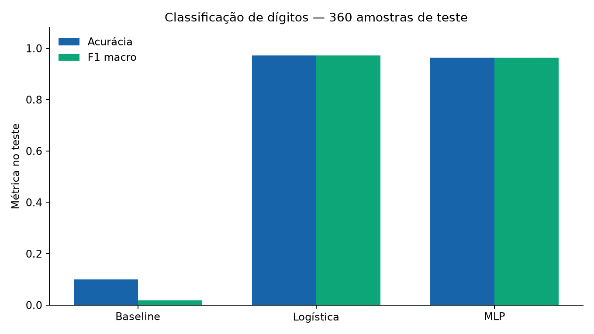
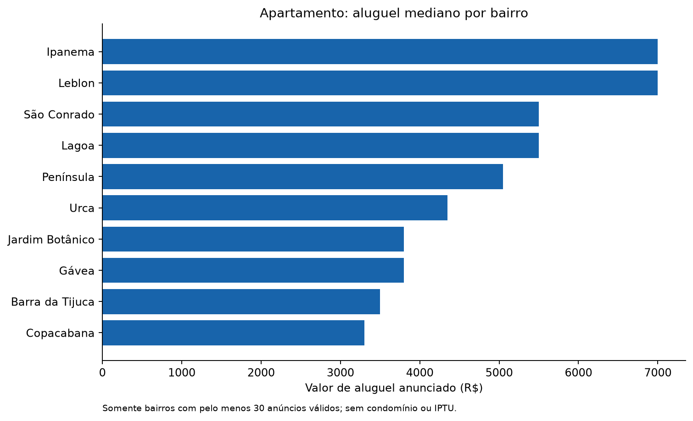

# Robert · projetos e estudos em dados

**Python, análise de dados e aprendizado de máquina — com projetos, estudos e próximos passos em um só lugar.**

Este repositório é o ponto central para encontrar, continuar e documentar meus trabalhos. O GitHub guarda a versão de referência; o Colab pode ser usado para executar os notebooks pelo link em cada pasta.

## Navegação rápida

| Quero… | Onde encontrar |
|---|---|
| Ver todos os trabalhos | [Catálogo por assunto e status](CATALOGO.md) |
| Continuar algo que comecei | [Próximos passos](PROXIMOS_PASSOS.md) |
| Explorar análises e modelos | [Projetos em andamento](projetos/) |
| Retomar uma ideia | [Rascunhos](em-andamento/) |
| Consultar exercícios | [Estudos](estudos/) |
| Entender versões anteriores | [Migração](docs/MIGRACAO.md) e [arquivo](arquivo/) |
| Começar um trabalho novo | [Fluxo de trabalho e modelos](COMO_TRABALHAR.md) |

## Demonstrações com execução verificada

| Projeto | Status | Material |
|---|---|---|
| [Classificação de dígitos — logística e MLP](projetos/classificacao-digitos/atividade-pratica-01-sklearn-pytorch-basics-1y956r/) | Concluído | Demonstração executada, com gráficos e resultados disponíveis |
| [Anúncios de aluguel — análise exploratória](projetos/analise-mercado-imobiliario/projeto-imobiliaria-1drcbx/) | Concluído | Demonstração executada, com gráficos e resultados disponíveis |
| [Vendas de videogames — plataformas e regiões](projetos/vendas-videogames/analise-games-1y8onn/) | Concluído | 16.598 registros, rankings e quatro gráficos verificados |

[Quadro de continuidade](QUADRO.md) · [Bases no Drive](docs/BASES_NO_DRIVE.md)

## Projetos integrados ao portfólio

| Projeto | Tipo e estágio |
|---|---|
| [Vendas da Amazon na Índia](projetos/vendas-amazon-india/) | Análise de dados em revisão |
| [Extinção animal — busca de espécies](projetos/extincao-animal/) | Aplicação JavaScript de estudo, com base editorial em revisão |

Código, documentação e próximos passos ficam nas pastas acima. Além dos 69 notebooks, o catálogo inclui estes dois projetos com arquivos Python e web.

## Outros trabalhos para explorar

| Conteúdo | Status | O que falta |
|---|---|---|
| [bacen selic 2023 ](projetos/coleta-dados-bacen/bacen-selic-2023-11k0ur/) | Em andamento | Explicar série, unidade e intervalo (o nome sugere 2023 inteiro, mas a consulta é apenas janeiro) |
| [Classificação de dígitos — logística e MLP](projetos/classificacao-digitos/atividade-pratica-01-sklearn-pytorch-basics-1y956r/) | Concluído | Demonstração executada, com gráficos e resultados disponíveis |
| [Estudo sobre SVC E LinearSvc ](projetos/estudos-machine-learning/estudo-sobre-svc-e-linearsvc-1b8yjj/) | Em andamento | Documentar dados e créditos, transformar comparação em tabela com métricas e tempo, fixar ano de referência para idade do veículo (datetime |
| [Anúncios de aluguel — análise exploratória](projetos/analise-mercado-imobiliario/projeto-imobiliaria-1drcbx/) | Concluído | Demonstração executada, com gráficos e resultados disponíveis |
| [Analise de Topicos em Emails ](projetos/topicos-emails/analise-de-topicos-em-emails-1badcb/) | Em andamento | Preservar três autores |
| [Trabalho Aprendizado Não Supervisionado ](projetos/ideb-regiao-norte/trabalho-aprendizado-nao-supervisionado-1z1dwg/) | Em andamento | Comparar com APRIORI para formar versão canônica |
| [Projeto Steam Games ](projetos/analise-jogos-steam/projeto-steam-games-1jnxam/) | Em andamento | Prioridade de portfólio após revisão: localizar fonte/licença/data do CSV, distinguir playtime de número de jogadores e owners de vendas |
| [SENSORES GALPÕES ](projetos/sensores-industriais/sensores-galpoes-1uaygj/) | Em andamento | Rotular dados como sintéticos, concluir regras de qualidade, tratar nulos e comparar antes/depois |

## Situação da coleção

**71 trabalhos cadastrados: 69 notebooks e 2 projetos com código Python ou web.**

- **Estudo:** 40 trabalhos (39 notebooks e 1 aplicação web).
- **Versão de referência:** 11 notebooks.
- **Em andamento:** 11 trabalhos (10 notebooks e 1 projeto Python).
- **Concluído no escopo demonstrativo:** 3 notebooks.
- **Rascunho:** 6 notebooks.

Cada pasta informa o conteúdo disponível, as dependências e o que precisa ser verificado. As três demonstrações em destaque foram executadas e têm resultados próprios; os demais trabalhos mantêm seus status e pendências. Outputs antigos das importações não são tratados como validação.

## Outros projetos no GitHub

| Projeto | O que faz |
|---|---|
| [BB Digital Week — extração](https://github.com/Inocentrax/Cronograma-BB-Digital-Week-2024) | PDF → Excel para organizar programação |
| [BB Digital Week — agenda](https://github.com/Inocentrax/Site-BB-digital-Week-2024) | Consulta web com filtros e JSON |
| [Quiz de estatística](https://github.com/Inocentrax/gamificacaoestatistica) | Jogo educacional com perguntas e personagens |
| [Pokédex](https://github.com/Inocentrax/js-developer-pokedex) | JavaScript e consumo de API |
| [Java básico](https://github.com/Inocentrax/dio-trilha-java-basico) | Exercícios de tipos, operadores e objetos |
| [Open source — DIO](https://github.com/Inocentrax/dio-lab-open-source) | Laboratório de contribuição |
| [Second Mind AI](https://github.com/Inocentrax/miniguia-estudos-notebooklm) | Guia de estudos e reflexões sobre IA |
| [dlib — notas](https://github.com/Inocentrax/Dlibs---Releases) | Apoio à preparação de ambientes de visão computacional |

## Organização e autoria

Trabalhos de cursos, livros e atividades coletivas mantêm suas referências e coautores nas respectivas pastas. Dados externos têm instruções de obtenção; não há licença única presumida para todos os datasets e materiais de terceiros.

[Critérios de publicação](docs/PADRAO_PUBLICACAO.md) · [Registro da organização](CHANGELOG.md)
