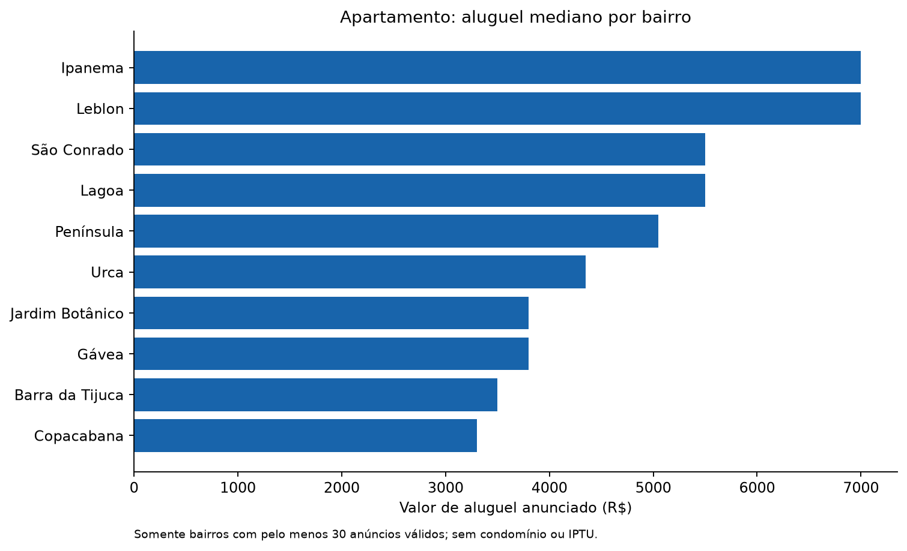
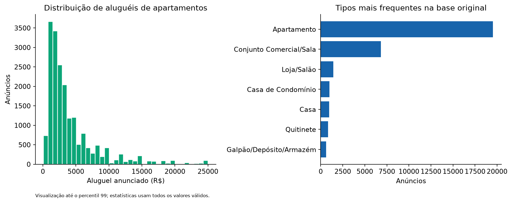

# Anúncios de aluguel — o que os dados mostram

Análise exploratória de 32.960 anúncios, com recorte de 19.525 apartamentos válidos. **O aluguel mediano do recorte foi R$ 2.700, sem condomínio ou IPTU.**

**Status:** Concluído no escopo de exploração desta base didática. Execução verificada em 15/11/2026. Os valores não representam uma cotação atual de mercado.

[← Catálogo](../../../CATALOGO.md) · [Notebook](notebook.ipynb) · [Abrir no Colab](https://colab.research.google.com/github/Inocentrax/portfolio-dados/blob/main/projetos/analise-mercado-imobiliario/projeto-imobiliaria-1drcbx/notebook.ipynb)



## Perguntas

- Como os tipos de imóveis se distribuem na base?
- Como os valores de aluguel de apartamentos variam?
- Quais bairros têm maiores medianas entre os que possuem ao menos 30 anúncios válidos?
- Quais informações faltam e como isso afeta custos calculados?

## Recorte e preparação

| Etapa | Anúncios |
|---|---:|
| Base original | 32.960 |
| Tipo Apartamento | 19.532 |
| Apartamentos com aluguel e área positivos | 19.525 |
| Apartamentos excluídos por essa regra | 7 |

Não foram preenchidos custos ausentes com zero. O total aluguel + condomínio só é conhecido para 18.780 anúncios do recorte. Os rankings usam a mediana e exigem ao menos 30 anúncios por bairro.

## Resultados observados

- Aluguel mediano: **R$ 2.700**.
- Média de aluguel: **R$ 4.744,61**, acima da mediana nesta distribuição assimétrica.
- Mediana de aluguel por m²: **R$ 30,23**.
- 52 bairros atingem o suporte mínimo. Leblon e Ipanema apresentam mediana de R$ 7.000 no recorte.



O histograma é limitado ao percentil 99 para leitura; os indicadores usam todos os apartamentos válidos. Preços de anúncio não são valores de transação, e o ranking não controla tamanho ou características do imóvel.

## Reproduzir

Com Python 3.12, a partir desta pasta:

```bash
python -m pip install -r requirements.txt
python analise.py
```

O script baixa a revisão fixa da base, confere seu SHA-256, mantém cache local e gera resultados.json, tabelas agregadas e duas figuras. Nenhum dado do Drive é necessário para esta versão.

## Dados e limites

Base do material Alura sobre pandas. [Origem, revisão e hash](data/README.md). O período e a representatividade da base não foram estabelecidos; não extrapolar os valores para o mercado atual. Anúncios podem não representar imóveis únicos.

## Evoluções opcionais

- Comparar bairros controlando área, quartos e outras características.
- Conferir período de coleta e possíveis repetições.
- Estudar sensibilidade dos rankings ao suporte mínimo.

## Arquivos

[analise.py](analise.py) · [notebook](notebook.ipynb) · [resultados](resultados.json) · [bairros-resumo.csv](bairros-resumo.csv) · [dados-ausentes.csv](dados-ausentes.csv). O notebook anterior permanece no histórico do Git e no Drive.
