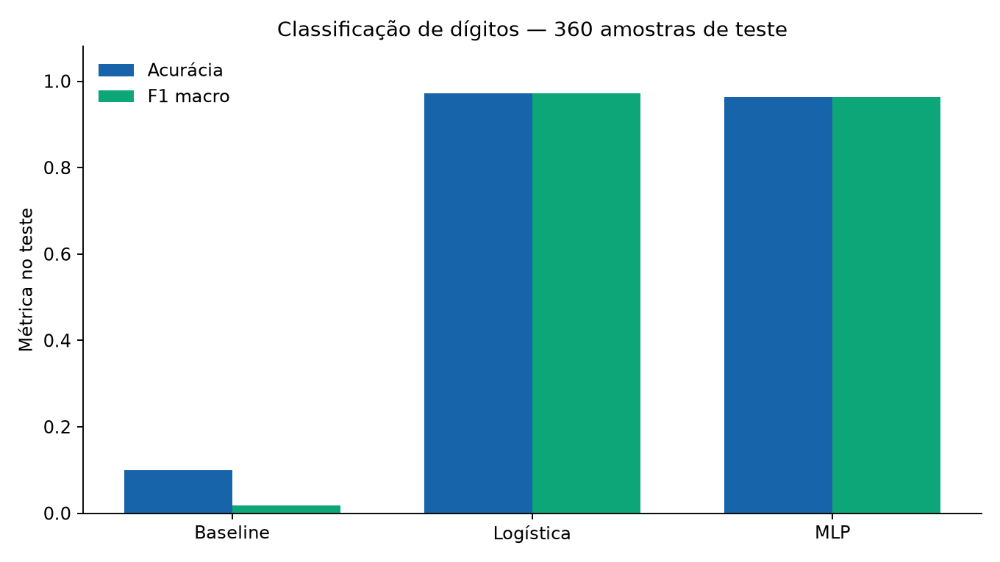
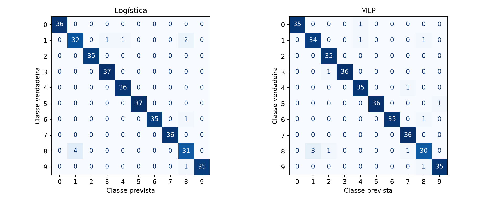
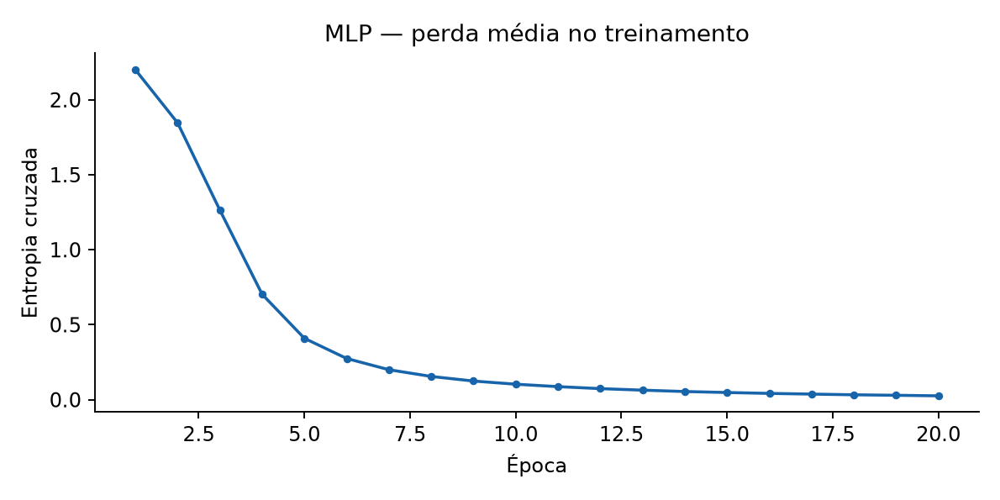

# Classificação de dígitos — logística e rede neural

Comparação reproduzível de um baseline, regressão logística e MLP em imagens 8×8. **A logística obteve 97,22% de acurácia nas 360 amostras reservadas para teste.**

**Status:** Concluído no escopo demonstrativo. Execução verificada em 15/11/2026.

[← Catálogo](../../../CATALOGO.md) · [Notebook](notebook.ipynb) · [Abrir no Colab](https://colab.research.google.com/github/Inocentrax/portfolio-dados/blob/main/projetos/classificacao-digitos/atividade-pratica-01-sklearn-pytorch-basics-1y956r/notebook.ipynb)



## Problema e dados

Reconhecer os dígitos de 0 a 9 no dataset Digits disponibilizado pelo scikit-learn: 1797 imagens, 64 atributos e dez classes. São 1437 amostras de treino e 360 de teste, com divisão estratificada e semente 42.

## O que foi feito

1. Dividir índices de treino/teste sem sobreposição.
2. Ajustar StandardScaler somente no treino.
3. Comparar baseline de classe mais frequente, regressão logística e uma MLP 64→64→32→10.
4. Treinar a MLP em CPU por 20 épocas, com Adam e entropia cruzada.
5. Avaliar apenas depois no teste reservado e salvar métricas e figuras.

## Resultado observado

| Modelo | Acurácia no teste | F1 macro |
|---|---:|---:|
| Baseline | 10,00% | 0.0182 |
| Logística | 97,22% | 0.9719 |
| MLP | 96,39% | 0.9635 |

Nesta execução, a rede neural não superou a regressão logística. A complexidade adicional, por si só, não garantiu melhor resultado. A comparação corresponde a uma única divisão e configuração, sem teste de significância.





## Reproduzir

Com Python 3.12, a partir desta pasta:

```bash
python -m pip install -r requirements.txt
python analise.py
```

O notebook contém o mesmo fluxo em células. O script gera resultados.json e as três figuras em assets/. O registro inclui versões, semente, hiperparâmetros e hash dos índices de teste. Diferenças de plataforma podem causar pequenas variações numéricas.

## Limites e evolução

- Uma única divisão estratificada e configurações fixas.
- Nenhuma conclusão sobre dígitos fotografados ou dados externos.
- Possíveis evoluções: validação cruzada, estabilidade entre sementes e análise de erros.

## Arquivos e créditos

[analise.py](analise.py), [notebook.ipynb](notebook.ipynb), [resultados.json](resultados.json) e [dados](data/README.md).

O trabalho evolui a atividade pessoal sklearn/PyTorch. Dados obtidos por sklearn.datasets.load_digits; a descrição e as referências originais acompanham esse carregador da biblioteca. O material anterior permanece no histórico.
