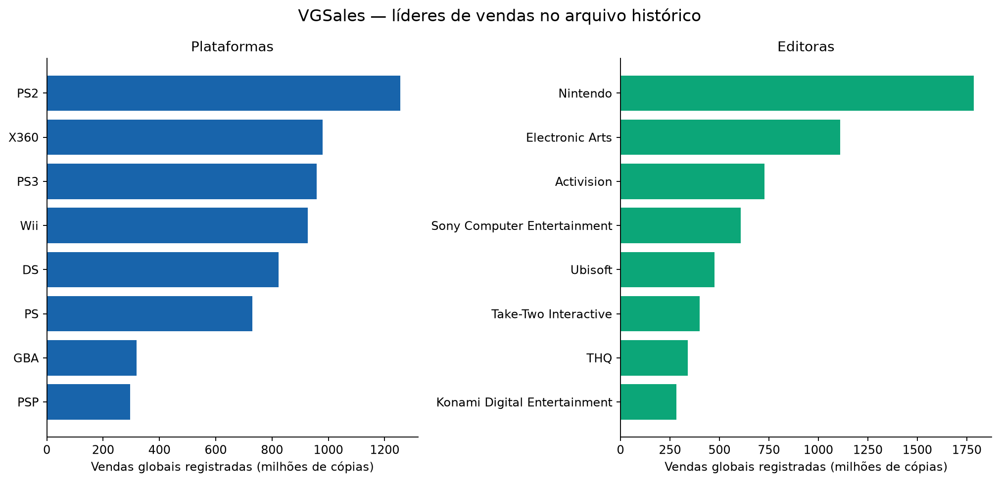
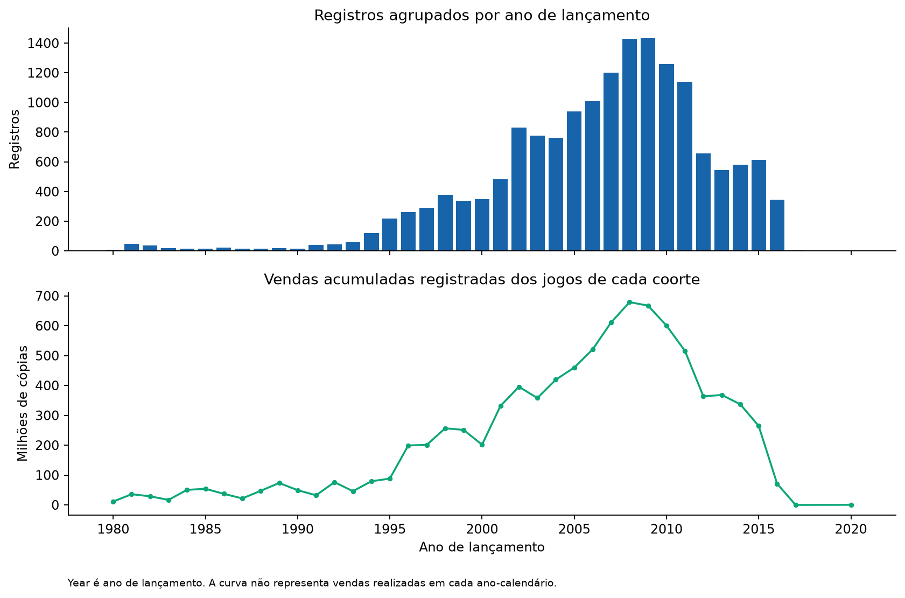
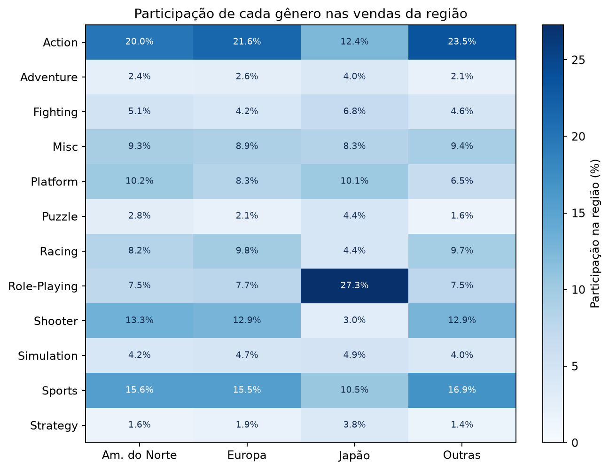
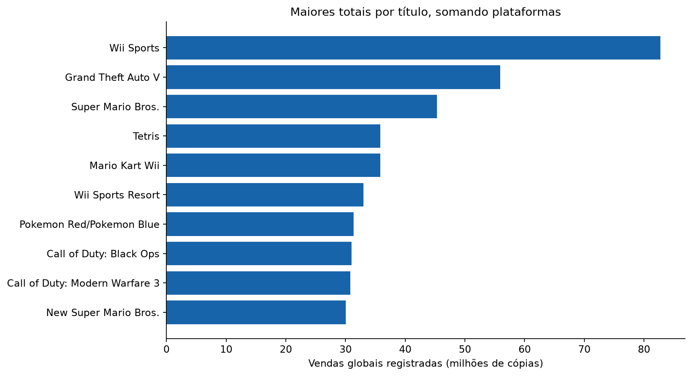

# Vendas de videogames — o que o histórico revela

Análise exploratória de **16.598 registros de jogos/plataformas**, cobrindo 31 plataformas. A Nintendo lidera o volume registrado; a Electronic Arts, a quantidade de registros.

**Status:** Concluído no escopo demonstrativo. Execução verificada em 15/11/2026.

[← Catálogo](../../../CATALOGO.md) · [Notebook](notebook.ipynb) · [Abrir no Colab](https://colab.research.google.com/github/Inocentrax/portfolio-dados/blob/main/projetos/vendas-videogames/analise-games-1y8onn/notebook.ipynb)



## Perguntas e resultados

| Pergunta | Resposta na versão analisada |
|---|---|
| Qual editora aparece em mais registros? | Electronic Arts: **1.351 registros** |
| Qual editora tem maior volume de vendas? | Nintendo: **1.786,56 milhões de cópias** |
| Qual plataforma tem maior volume? | PS2: **1.255,64 milhões de cópias** |
| Qual título tem maior total por nome? | Wii Sports: **82,74 milhões de cópias** |
| Qual coorte de lançamento acumula mais vendas registradas? | Jogos lançados em 2008: **678,90 milhões de cópias** |

Registros não são jogos únicos: um título pode aparecer em várias plataformas. Publisher é editora; o arquivo não identifica desenvolvedoras nem lojas de venda. Todos os valores descrevem este snapshot histórico.

## Dados e preparação

A base enviada foi conferida: 11 colunas, 16.598 linhas e MD5 idêntico ao registrado no [arquivo de referência de Gregory Smith](https://zenodo.org/records/5898311). A descrição de origem informa vendas regionais em milhões de cópias e ano de lançamento.

| Verificação | Resultado |
|---|---:|
| Ano ausente | 271 registros — 1,63% |
| Editora ausente | 58 registros — 0,35% |
| Linhas que um dropna geral eliminaria | 307 — 1,85% |
| Linhas preservadas na análise geral | 16.598 |
| Linhas usadas nas análises por ano de lançamento | 16.327 |
| Duplicatas de linhas completas | 0 |

Ano ausente exclui o registro somente das análises por ano. Editora ausente vira “Não informada”. Não há imputação de vendas. Foi conferida também a diferença entre soma regional e Global_Sales: máximo de 0,02 milhão, compatível com arredondamento dos campos.

## Ano de lançamento e regiões



O arquivo não informa quando cada venda ocorreu. A curva agrupa vendas acumuladas dos jogos pelo ano de lançamento; não mede faturamento ou vendas anuais da indústria. A cauda de anos com poucos registros não deve ser interpretada como retração atual do mercado.



Cada coluna do mapa soma 100% dentro da região, permitindo comparar composição por gênero. O Japão tem uma composição diferente das demais regiões, com maior participação de Role-Playing nesta base.



## Reproduzir

Com Python 3.12, a partir desta pasta:

```bash
python -m pip install -r requirements.txt
python analise.py
```

O script aceita vgsales.csv local ou obtém a cópia pública indicada, verifica SHA-256, grava resultados.json, seis tabelas e quatro figuras. No Colab, o notebook contém o mesmo código em células.

## Arquivos

- [analise.py](analise.py): fluxo completo e verificações.
- [notebook.ipynb](notebook.ipynb): versão interativa.
- [resultados.json](resultados.json): métricas, parâmetros de fonte e ambiente.
- [qualidade-dados.csv](qualidade-dados.csv), [plataformas.csv](plataformas.csv), [editoras.csv](editoras.csv), [titulos.csv](titulos.csv), [coortes-lancamento.csv](coortes-lancamento.csv) e [generos-regioes-percentual.csv](generos-regioes-percentual.csv).
- [data/README.md](data/README.md): origem, unidade, dicionário e checksums.

## Limitações e evoluções

O levantamento não é um censo completo da indústria, não representa o mercado atual e não identifica Steam ou outras lojas. Agrupar pelo nome pode reunir versões distintas de um título. As conclusões são descritivas; nenhuma previsão foi treinada.

Evoluções possíveis: comparar a cobertura entre períodos e plataformas, investigar títulos homônimos e estudar como os rankings mudam por região.

O projeto evolui o notebook pessoal Analise_Games.ipynb; as versões anteriores permanecem no histórico do Git e no Drive.
